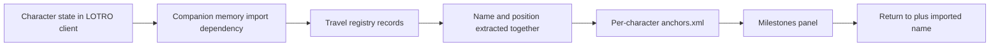

# Milestone name origin and named research database

Research date: 2026-11-08. Continues the [findings supplement](2026-11-08-findings-and-developer-notes.md). This work changes research documentation, derived data, and offline tooling only.

## Result

**Companion obtains the exact destination name from a character travel record read during client import.** Its milestone panel displays that imported name. The inspected public code does not derive the name from the nearest map landmark or maintain a complete named milestone lookup table.

The [named database](named-catalogue/README.md) contains **37 destinations** with observed English names, separate object and observed coordinates, world region, zone/territory hierarchy, research IDs, and source identifiers. This is the complete supported named subset of the evidence currently available, not a complete list of bindable milestones in the game. **314 of the 351 source markers are omitted** because there is no supported exact destination name for them in this evidence. Their names are not filled from nearby settlements or generic area labels.

## 1. Trace from the UI to the data source



The edges inside the current external memory dependency are not available as public source in the repositories inspected. Public application code establishes invocation of memory import; the public travel-record extractor and saved fixtures establish the name/position contract. An older published binary corroborates the bridge, with the version limitation below.

| Step | Source and behavior |
|---|---|
| Start character import | [ClientImportDialogController.java:149–185](https://github.com/LotroCompanion/lotro-companion/blob/fa4c084467b3c957d1660d2fb847e6ea42e1f228/src/main/java/delta/games/lotro/gui/clientImport/ClientImportDialogController.java#L149-L185) selects a LOTRO process, creates `WinInterface` memory access, a `MemoryExtractionSession`, and the dependency's `MainExtractor`, then starts an import worker. |
| Decode travel records | [TravelRegistryExtractor.java:41–72](https://github.com/LotroCompanion/lotro-data-extractor/blob/d9a854220477675721f7264f8a57974bdf025ad8/src/main/java/delta/games/lotro/extractors/travels/TravelRegistryExtractor.java#L41-L72) reads a travel-type-keyed map, then obtains name and `DatPosition` from each record. |
| Hold the result | [AnchorStatus.java](https://github.com/LotroCompanion/lotro-core/blob/2356eef3c74140db0cebfae5b5c7a91b7839330f/src/main/java/delta/games/lotro/character/status/travels/AnchorStatus.java) stores TravelLink type, name, and extended position. |
| Store the snapshot | [AnchorsStatusIo.java](https://github.com/LotroCompanion/lotro-core/blob/2356eef3c74140db0cebfae5b5c7a91b7839330f/src/main/java/delta/games/lotro/character/status/travels/io/AnchorsStatusIo.java) selects the character's `anchors.xml`; [AnchorsStatusXMLWriter.java](https://github.com/LotroCompanion/lotro-core/blob/2356eef3c74140db0cebfae5b5c7a91b7839330f/src/main/java/delta/games/lotro/character/status/travels/io/xml/AnchorsStatusXMLWriter.java) serializes the fields. |
| Load the panel | [TravelsStatusWindowController.java:56–57](https://github.com/LotroCompanion/lotro-companion/blob/fa4c084467b3c957d1660d2fb847e6ea42e1f228/src/main/java/delta/games/lotro/gui/character/status/travels/TravelsStatusWindowController.java#L56-L57) loads anchors and supplies them to the milestone panel. |
| Display the exact name | [AnchorsStatusDisplayPanelController.java:84–114](https://github.com/LotroCompanion/lotro-companion/blob/fa4c084467b3c957d1660d2fb847e6ea42e1f228/src/main/java/delta/games/lotro/gui/character/status/travels/AnchorsStatusDisplayPanelController.java#L84-L114) reads `status.getName()` and prepends `Return to `. Zone text is a fallback when no name exists, rather than the normal destination-name source. |

The exact field read is:

```java
String name=(String)travelRecord.getAttributeValue("47172757");
```

The accompanying position comes from attribute `111647278`; the registry map uses attribute `194458403`. The supplied character snapshots demonstrate that the resulting name is a bare destination name, without the `Return to` prefix or chat's parenthetical territory.

### Public dependency boundary

The current application [POM](https://github.com/LotroCompanion/lotro-companion/blob/fa4c084467b3c957d1660d2fb847e6ea42e1f228/pom.xml) depends on `delta-lotro-memory 6.8.1` and `delta-lotro-dat-utils 11.13`. No source repository for the memory dependency was found in the inspected LotroCompanion and maintainer public repository listings. This means source was not located; it does not establish that the source cannot exist elsewhere.

The public distribution revision `527341b7176a0ee1e55f35b7648b83a5c4a9acbc` contains an older [memory 5.19 JAR](https://github.com/LotroCompanion/lotro-companion-distrib/blob/527341b7176a0ee1e55f35b7648b83a5c4a9acbc/lotro-companion/lib/delta-lotro-memory-5.19.jar). ZIP inventory and printable symbol inspection found `TravelsDataExtractor.class`, references to `TravelRegistryExtractor`, `AnchorsStatusManager`, `AnchorsStatusIo`, and `updateAnchors`; it contains no Java source entries. This corroborates the architecture of that older release. Symbol inspection is not a complete bytecode/control-flow analysis and is not proof of the exact current 6.8.1 implementation. The library was not executed. [Inspection evidence and hash](evidence/2026-11-08-memory-import-symbols.json) are retained.

The public static extraction code copies an object's ordinary name into [map markers](https://github.com/LotroCompanion/lotro-tools/blob/bcda345998795b447f94d1e53fd117ad161f882c/src/main/java/delta/games/lotro/tools/extraction/geo/markers/MarkerUtils.java#L24-L39). All 351 milestone object labels are generic. The inspected source does not establish the game's internal algorithm that originally creates a travel-record name, nor an exported per-placement field containing every milestone's exact bind name. Named transport routes, landmarks and geographic labels are useful context, but are not a demonstrated complete binding-name table.

## 2. Named evidence used for the database

Only travel-related files under the stakeholder-provided `D:\LOTRO Exports\characters` tree were inspected: `anchors.xml` and the corresponding `skills.xml`. No inventory, account credentials, character names, or unrelated character data were copied.

- Twelve character export pairs yielded **42 named milestone-anchor observations** representing **36 distinct name/world/zone groups**.
- Every included anchor's TravelLink type joined through the reference skill catalogue to a character skill with `available="true"`.
- Twenty-five non-milestone anchors were skipped. No selected milestone observation was missing its name or required geography/coordinates, and none was excluded for unavailable skills in this input snapshot.
- Names, world/zone context, raw coordinate precision, skill IDs, TravelLink codes, source-file hashes and filesystem modification times are retained in [the minimized input fixture](evidence/2026-11-08-named-database-input.json). Export directory aliases provide provenance without inferring character identity. Modification time is not game observation time.
- **Echad Vothui** contributes one additional destination: its name and territory were observed in the stakeholder's successful-use message; the pinned named landmark supplies its contextual position. Its position is explicitly `namedLandmark`, not an imported anchor or measured arrival.

No other destination name is invented to increase coverage. The 314 omitted markers remain only in the separate raw research inventory, not as empty or guessed rows in this named database.

### Repeated snapshots provide additional coordinate evidence

Beorninghús and Durin's Threshold each have two imported anchor positions; Swain's Guild-hall and The Twenty-first Hall each have three. Their positions differ even though the names and selected milestone object agree. For example, the two Durin's Threshold positions are `-8.0583105, -116.138275` and `-8.080546, -116.11646`.

This reinforces the need to retain all observations. It does not prove a single fixed arrival point per milestone. Differences might reflect bind position, arrival selection, character/client context, or snapshot/version differences; controlled E06 measurements are still required. The earlier object-versus-arrival explanation remains plausible rather than confirmed.

## 3. How marker candidates were attached

For each named observation, the offline builder ranks **all source milestone markers in the same world region** by Euclidean coordinate separation. Research screening requires:

1. A name and finite coordinates with known world region and zone.
2. A nearest marker in the same zone.
3. Separation at most `0.1` game coordinate degrees.
4. A second-nearest/nearest separation ratio of at least `3`.
5. Every observation in a name/world/zone group selecting the same marker.

These thresholds are explicit **research screening settings**, not a calibrated runtime tolerance or approval for automatic binding repair. All 37 groups pass, and their marker IDs are distinct. The maximum separation among the 42 imported anchors is approximately `0.038543`; Echad Vothui's landmark-to-marker separation is approximately `0.044999`. The smallest runner-up ratio across the retained observations exceeds `91`. These are game coordinate distances, not metres.

Every relationship is labelled `spatialCandidateNotExplicitUpstreamLink`. Exact names are observed; marker associations remain derived. Being a clear spatial candidate does not establish universal name uniqueness, current live bindability, or map projection accuracy. Missing or ambiguous future observations must be omitted until review rather than forced into the nearest entry.

## 4. Data contract

| Field | Meaning |
|---|---|
| `id` | Locally allocated research UUID, preserved in an identity ledger. It is not a game ID, marker ID or approved TWII production schema. |
| `name`, `nameLanguage`, `nameStatus` | Exact observed English name and whether it came from an exported binding or reported successful use. No translations are invented. |
| `worldRegion` | Numeric world code plus the separate geographic region entity ID/name. |
| `zone`, `geographicHierarchy` | Area/dungeon identity and its territory/region ancestors, including IDs and source names. |
| `marker` | Candidate milestone object's source ID, shared template DID, category, exact object coordinates, zone, source XML path, and pinned revision. |
| `markerAssociation` | Explicit inferred status, maximum separation, minimum runner-up distance and ratio, and context agreement. |
| `positionObservations` | Every imported-anchor or named-landmark coordinate, original precision, provenance and relevant skill/TravelLink evidence. No source position is silently replaced with an object position. |
| `relatedLandmarkNameCandidates` | Optional landmark IDs with the exact same English name. These are name-only candidates, not proven milestone identities or translated-name mappings. Absent candidates are omitted. |

The CSV flattens these fields for review, including area/territory IDs, object and first observed coordinates, observation kind/count, and inferred association status. Its first observed coordinate is a representative source observation, not a uniquely established arrival point. JSON retains all observations.

The identity ledger uses a name/world/zone lookup to preserve initially allocated research IDs on rerun. A future rename, zone change, reused name at a second stone, or competing alias requires review; the ledger is not a universal identity algorithm. Upstream ID changes must not silently rewrite research IDs. The previous seven ID-change examples remain relevant.

## 5. Files and rebuild

- [Readable named list](named-catalogue/README.md)
- [JSON database](named-catalogue/named-milestones.json)
- [CSV database](named-catalogue/named-milestones.csv)
- [Research identity ledger](named-catalogue/identity-ledger.json)
- [Offline builder](tools/Build-NamedMilestoneCatalogue.ps1)
- [Minimized named observations and reference entities](evidence/2026-11-08-named-database-input.json)
- [Raw 351-marker inventory](evidence/2026-11-08-milestone-catalogue.csv), retained separately from the named subset

From the research checkout, using PowerShell 7:

```powershell
./plans/milestone-management/tools/Build-NamedMilestoneCatalogue.ps1
```

The builder reads only persisted fixtures and the pinned marker CSV. It performs no network access or live game import and does not read or modify plugin state. New export or chat observations require a provenance-preserving fixture update and review. Keep the identity ledger when rebuilding. The table in `named-catalogue/README.md` is a documentation snapshot and should be refreshed when the JSON changes.

Validation performed: all 37 entries have names, known world/zone, finite coordinates, unique research IDs and unique candidate marker IDs; 43 position observations are retained; candidate context agrees for every observation; 314 unknown-name markers are absent from the named output. Rebuilding from the persisted inputs preserved JSON and ledger byte hashes. No plugin runtime behavior was changed or tested by this task.

## 6. What would extend coverage

The source trace explains why GitHub's marker catalogue alone cannot currently supply the missing exact names: those names are available to Companion for **the character's recorded bindings**. More named coverage requires additional reliable evidence, such as further exported bindings, controlled bind/use observations, or an upstream extractor that exposes a proven per-placement bind-target name.

A useful future maintainer question is whether milestone placement, telepad or travel-binding metadata has a name reference that the current static map extractor discards. That field and its semantics have not been demonstrated here. No outreach has been performed. Name-only nearest-landmark guesses must stay outside this observed-name database.
