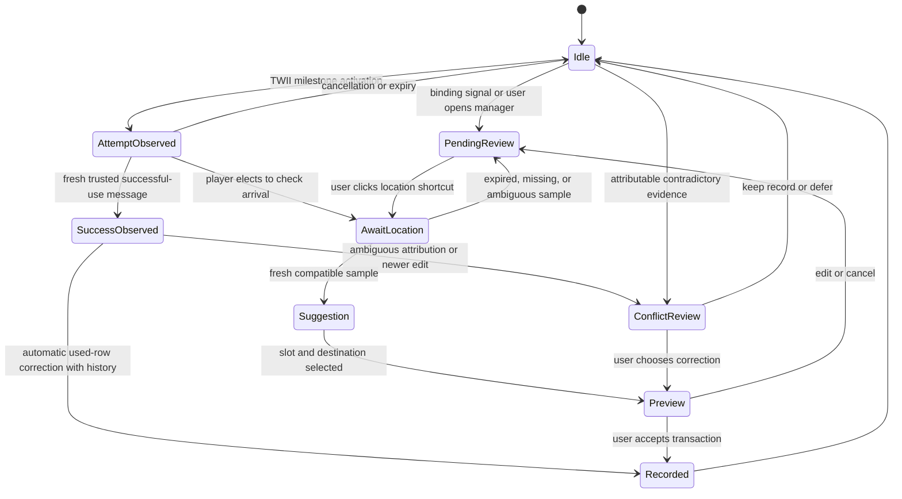

# Milestone management — proposed specification

**2026-11-14 constraint update:** the authorized [catalogue/LOC debug increment](2026-11-14-catalogue-debug-guess.md) remains session-only. Future persistence must use a dedicated Character-scope store outside global options and save numeric skill-ID→immutable numeric destination-ID records, without plaintext destination names. See [storage research](2026-11-14-character-storage.md). References below to raw observed text mean session-local evidence; they do not authorize serializing names. Unknown catalogue matches remain unresolved, and custom plaintext-location persistence is deferred. This constraint takes precedence over older persistence proposals in this draft.

**2026-11-08 supplement:** [Findings and developer requirements](2026-11-08-findings-and-developer-notes.md) adds verified source/export facts, stakeholder-reported runtime results, and constraints for later execution. The current approved debug prototype is smaller than the proposed iteration 1a below: bind-slot selection, successful-use diagnostics, and an in-memory text table, without location-command capture or persistence. That supplement records the evidence state on 2026-11-08. The 2026-11-09 plan below supersedes its undecided automatic-repair policy; implementation still requires the relevant iteration gates.

Version: research draft 0.17, 2026-11-09. **Not approved for implementation.** The stakeholder direction is now bind-time proximity suggestions followed by self-healing after a tracked successful use. See the [updated approach and implementation plan](../2026-11-09-milestone-proximity-and-self-healing.md). Tracking precedes repair, production text integration follows, and map view remains last. This planning update does not expand the current debug-only, in-memory execution slice. Runtime event trust, locale coverage and location-command behavior still require validation.

## Product intent

Let a player recognize and use their milestone destinations from every relevant TWII view, keep the plugin's records aligned with the game with little effort, and repair mistaken records without losing useful information.

Success is a destination the player can trust and correct. Automatic detection is one way to reduce maintenance; it is not a prerequisite for having a useful binding manager.

### Proposed scope

The full feature covers manual setup, named destinations, overview-map placement, assistance after binding, location suggestions, post-travel checks, repair/history, catalogue maintenance, and optional Companion snapshot import. The target feature is intentionally split into three independently reviewable and testable iterations: build a reliable data foundation first, repair/reconcile it from use second, and only then integrate it into production views, with map view last. Iteration 1 starts with a still smaller **1a debug-only vertical slice**: trigger from the bind message, capture the player-selected skill/location through the popup flow, and show the candidate in a dedicated text-only diagnostic window. It does not save production bindings or integrate with existing views. After that slice is reviewed, **1b** hardens and persists the tracking data in the diagnostic workflow; production text views wait until iteration 3.

**Release target (Q1=B), delivered in three iterations:** use the datamined catalogue and stable binding model to make milestone tracking reliable; add evidence-based mismatch repair and recovery; then integrate trusted records into production views, with maps last. The same feature goal remains manual setup plus binding/location assistance, with broader travel reconciliation and character-specific Companion import deferred. Iteration 1a first proves bind-popup-to-location capture in a dedicated text-only diagnostic window; it creates no accepted/persisted production binding and changes no normal view. Iteration 1b persists and hardens the tracker within the diagnostic workflow, so tracking data can accumulate and be reviewed without appearing in production views. Iteration 2 adds successful-use mismatch detection and use-based repair against that diagnostic data. Correlate the clicked TWII quickslot's skill ID with the successful-use chat message, whose dynamic Return to name identifies the destination in two stakeholder-verified examples; the stakeholder confirms it appears only after travel succeeds. E04 must capture ChatType, duplicate/order behavior, locale variants and parser boundaries before using that signal. Iteration 2 will automatically correct the used skill after an unambiguous, fresh and trusted clicked-skill/success-message pair, with revisions, before/after history and undo. A uniquely resolved catalogue key can be updated too; otherwise preserve the exact observed destination text and leave marker/map association unresolved. Do not require a complete named catalogue to collect or correct slot-to-text observations. The existing manager and **Fix now** remain the fallback for ambiguous evidence and explicit manual repair. The medium-sized mismatch prompt matches the active Classic/Mini window style, is movable, saves and reuses its position, and starts to the right of the play area. Whether it takes focus or blocks input remains open. Iteration 3 surfaces trusted records in production text views first, then adds reviewed map placement and map access as the final step; it does not change tracking or repair rules. E01–E04 validate the remaining signal/interaction assumptions; learned-skill identification is established behavior in the existing codebase; E05 remains optional corroboration/fallback research. Implement manual flows across existing client languages; begin bind/location detection on EN/DE/RU. The new milestone UI may use English copy on ES/RU clients in the first version; RU event parsing remains Russian. “Major” describes product significance here; semantic version and changelog classification remain undecided.

Inventory travel items, route optimization, automatic in-game rebinding, a full world-map replacement, housing ownership management, and passive-skill cooldown modelling are separate features. Shared architectural seams are sensible; implementing them here is not necessary.

### Product invariants

1. Recording or clearing a TWII location does not change the game's actual milestone binding. Use “Record location” and “Forget recorded location”; avoid a button simply called “Bind.”
2. Never change a destination from ambiguous or weaker evidence. A fresh, trusted success attributable to exactly one clicked skill may correct that skill automatically, with an explanation and undo. Resolving a physical destination key or map marker requires its own unambiguous evidence.
3. Separate skill identity, destination identity, and evidence connecting them. A known location with an unknown slot remains an unassigned observation.
4. A failed observation is not a failed binding. Missing chat, timeout, cancelled travel, or unavailable localization leaves the record intact.
5. Keep the real skill shortcut ID unchanged in all views. Recording a destination never creates a fictitious travel skill or bypasses game restrictions.
6. Bindings are character-specific. Account defaults may contain UI preferences, never another character's destinations.
7. Map drawing, distance matching, and text naming consume the same destination identity but different presentation/location data.
8. All accepted changes are reversible, subject to an explicit and bounded history policy. No undo may overwrite a later edit without a new review.
9. Datamined existence does not imply learned, obtainable, accessible, or currently bindable.

## Domain model

### Separate static catalogue from character state

| Object | Required concepts | Why |
|---|---|---|
| Milestone skill definition | Canonical skill ID; slot ordinal; travel-link code; localized native names/description discriminators; supported/experimental status | Stable identity independent of translated UI text and catalogue array order. |
| Destination | TWII stable destination key; localized display names/aliases; physical-world region; territory/area/dungeon IDs; story/version qualifier; object position; optional arrival envelope; source revision and source IDs; availability/coverage notes | Identity, naming, and geography must survive data updates. |
| Map placement | Destination key; TWII map ID; asset/reference version; logical pixel anchor or calibrated transform; projection quality; optional representative/interior flag | A map anchor is not necessarily a physical coordinate. One destination may appear on multiple maps. |
| Character binding | Skill ID; optional canonical destination key; exact observed destination text/territory/locale; resolution state; custom location; revision; source; acceptance/update time; observation time if known; review/history references | Separates a reliable slot-to-text observation from an unresolved physical location. Automatic use corrections are explicit, reversible transactions. |
| Observation | Type; session ID; event sequence; observation time; asserted or known skill ID; raw/normalized location; source provenance; referenced binding revision; candidate set; expiry | Prevents old or unrelated evidence from being applied to current state. |
| Edit transaction | Before/after binding snapshots; touched skill IDs and expected revisions; source; user decision; time; undo relationship | Wrong-slot correction can affect more than one slot and must be atomic. |

Use explicit namespaces: `skillId`, `travelLinkCode`, `destinationKey`, `worldRegionCode`, `geoAreaId`, `sourceMarkerId`, `templateDid`, `mapId`. Never pass an unqualified `id` between these layers. Preserve source numeric IDs as canonical strings at serialization boundaries.

### Skill-to-travel-link mapping established by source

| Slot | Skill ID | Companion travel-link code | In current TWII |
|---:|---|---:|---|
| 1 | `0x700256BA` | 3 | Yes |
| 2 | `0x70025792` | 15 | Yes |
| 3 | `0x70025793` | 16 | Yes |
| 4 | `0x70025794` | 17 | Yes |
| 5 | `0x70025795` | 18 | Yes |
| 6 | `0x70025796` | 19 | Yes |
| 7 | `0x7002FF62` | 26 | Yes |
| 8 | `0x7002FF61` | 27 | Yes |
| 9 | `0x7002FF60` | 28 | Yes |
| 10 | `0x7002FF5F` | 29 | Yes |
| 11 | `0x7002FF63` | 20 | Yes |
| 12 | `0x7002FF64` | 21 | No; explicitly ignored in curated input |
| 13 | `0x7002FF66` | 22 | No; explicitly ignored in curated input |
| 14 | `0x7002FF67` | 23 | No; explicitly ignored in curated input |
| 15 | `0x7002FF68` | 24 | No; explicitly ignored in curated input |
| 16 | `0x7002FF5E` | 25 | No; explicitly ignored in curated input |

The manager should derive rows from supported, learned skills by default, with an explicit way to inspect unavailable/unrecognized entries if needed. Do not show 16 active buttons merely because 16 definitions exist. Unknown imported skill types remain quarantined for review; do not treat hunter camps or instance-return anchors as milestone slots.

Preserve the current `data/skill_input.toml` exclusions until the stakeholder and live evidence establish a reason to change them. The registry table documents identities for interpretation; it is not a proposal to expose every entry.

## Evidence and reconciliation

### User-facing states

- **Location not recorded:** the skill may be usable in-game; TWII does not know its destination.
- **Recorded:** a user accepted a bind-time destination/import, or a qualifying successful-use transaction corrected the record. Detail shows source and date.
- **Checked after travel:** fresh, attributable evidence was consistent with this exact binding revision. It is still not a lifetime guarantee.
- **Review suggested:** there is conflicting or unresolved evidence. Keep the last accepted record and show the reason.
- **Observed after use, catalogue unresolved:** retain the exact destination text, territory, locale and provenance for the identified skill; do not claim a physical marker. A conflicting old placement remains historical rather than confirmed current data.
- **Location unavailable in catalogue:** retain unresolved/custom observations while naming or projection is unavailable.

Learned-skill availability and map-projection quality are independent fields, not extra confidence levels. Avoid a single percentage score: no calibrated probability model exists. A manual record is not “low quality” solely because it is manual.

An unidentified rebind makes the overall set potentially stale without proving which row is wrong. Show a set-level reminder such as “One milestone change has not been recorded,” with its date and review action. Do not leave a green “all checked” summary above that reminder, mark every row incorrect, or let old row-level checks imply that nothing has changed since. Individual evidence retains its date and binding revision.

### Decision table

| Evidence | Allowed result | Forbidden inference |
|---|---|---|
| User picks slot and destination and accepts preview | Record new binding transaction | That the game was rebound by TWII |
| User drops a known milestone skill | Select that slot | That its bound destination was read |
| Bind message with no verified slot field and exactly one learned milestone skill returned by the game method | Associate the pending event with that sole slot; keep the destination pending location review | Treat the bind message as having supplied the slot or destination |
| Bind message with multiple learned milestone skills returned by the game method | Offer labelled selection containing only those learned skills, even if their slot numbers have gaps | Infer learned status from a contiguous slot range or guess one skill |
| Fresh user-requested location near a known object | Suggest compatible destinations | Infer the skill number |
| TWII milestone click | Record attempted skill and current binding revision | Cast succeeded or destination reached |
| Fresh trusted successful-use message attributable to exactly one TWII milestone click | Correct that skill automatically; retain raw text/context, history and undo; resolve canonical key only when unique | Swap/restore another skill, infer an unknown marker, or overwrite a newer edit |
| Cooldown change | Add supporting observation if tested | Attribute the cast to one of several shared-cooldown skills |
| Regional entry matching expected area | Add weak consistency evidence | Exact milestone confirmed |
| Regional entry differing from expected area | Offer a check if temporal attribution is credible | Replace destination or disable skill |
| Same-area travel/no regional message | Remain unverified | Binding is wrong or travel failed |
| Fresh post-arrival coordinates with an attributable skill | Mark consistent evidence or propose correction | Assume arrival if sample could still be from origin |
| Imported anchor snapshot | Preview exact slot plus reported name/location; accept per row | Treat import time as game-observation time |

### Interaction state machine



“Recorded” here is a transaction outcome, not a global state that prevents subsequent observations. Multiple unresolved binding events belong in a bounded queue; do not collapse two rapid rebindings into one assumed event. Duplicate-message suppression may merge only evidence that demonstrably belongs to the same event.

### Timing and attribution rules

Use monotonically ordered session events and binding revisions. Wall-clock timestamps are for display/import provenance, not enough to correlate casts. Pending travel context expires on a tested timeout, a newer conflicting action, character/session change, or explicit cancel. Do not persist an active cast correlation across reload.

The location action associates a fresh sample with a specific pending review. If `/loc` cannot carry a request token, treat correlation as conditional: use a narrow pending window, reject samples predating the click, and handle another plugin issuing `/loc` in the same window. Never attach an unrelated historical location merely because the popup is visible.

A narrow time window cannot identify which requester caused an otherwise identical location message. If that distinction cannot be observed, show the sampled location for explicit confirmation and retain the attribution limitation. Do not promise automatic rejection of every other plugin's simultaneous request. “Check here” verifies location consistency; by itself it cannot establish that a particular skill was successfully used.

There may be no reliable “loading finished” event. The fallback is an explicit **Check arrival** click after the player sees they have arrived. A fixed delay after initiating a cast is insufficient evidence of arrival. Missing origin samples reduce the ability to reject pre-travel samples and must be reflected in the result.

Candidate ranking uses compatible coordinate-region/interior context first, then measured spatial distance and ambiguity margin, then names/area evidence as supporting cues. Require both an absolute distance limit and separation from alternatives. Do not fill unknown context from the saved binding being tested; that would make the test circular.

## User journeys and UI concepts

The destination-first text label and tray policy are settled by the stakeholder: use `Destination · Milestone N`, and keep each learned, enabled milestone in the tray while also drawing its recorded destination on the appropriate map when placement is supported. Remaining presentation questions include Q4 prompt focus/input behavior and overlapping map marker selection.

The following wireframes express information and actions, not a proposed final visual style. Layout, dimensions, colors, and placement await stakeholder preferences.

### A. Review/setup manager

Entry points: a visible Milestones item in the existing menu/options, a supplemental `/travel milestones` command, and an action on a milestone shortcut's context menu. A hidden chat command alone is insufficient discovery. Companion import controls are excluded from this release's manager.

```text
Milestones                         [Review 1]

Skill             Recorded destination          Status
Return Home       South Bree · Bree-land         Recorded
Return Home 2     Not recorded                   —
Return Home 3     Galtrev · Dunland               Review suggested

Selected: Return Home 3
Recorded: Galtrev · Dunland
New observation: location near [candidate], after [event]

[Choose location...] [Check here] [Show on map]
[Review history]     [Forget recorded location...]
```

Show native skill icon/slot identity alongside destination. Keep all learned slots accessible, including unknown destinations. Avoid relying on identical milestone icons to distinguish slots. Keyboard focus order, scrollable lists, font settings, and long localized names are part of the design.

The destination picker supports search, geographic grouping, story-version qualifiers, aliases, and a small candidate shortlist. Search and filter must not erase a pending selection. Display exact catalogue name plus region/context; allow preview before accepting. “None of these” and “Location missing” remain usable escape paths.

### B. Binding assistance

The [native-tooltip/location-click feasibility note](2026-11-09-native-tooltip-and-location-click.md) records an Alias action carrying the selected skill ID, request token and expanded location to TWII's own command. The limited [2026-11-14 debug trial](2026-11-14-mousedown-trial.md) now implements that command and MouseDown switching; native dispatch ordering remains unverified. Preserving a real skill's native hover tooltip while that same area runs only the Alias is still an E11 question; do not assume event forwarding or mouse visibility provides selective hover/click pass-through. Number-over-icon styling and numbering normal quickslot views are separate design candidates, with numbers tied to skill identity and sorting preserved.

After the supported English bind signal (“This location is now bound to your milestone skill.”) or a verified locale equivalent, offer one small non-modal prompt: **Record your milestone change**. The signal supplies neither slot nor location. Read the learned milestone skills using the game's learned-skill method. Learned skills cannot be unlearned, but players may skip slot numbers, so do not infer the learned set from a contiguous range:

- **Exactly one learned milestone skill:** show its identity (for example, **Return Home 1**) and offer **Use my location**. Do not make the player choose a slot; the button click requests a fresh `/loc` sample or supported `;loc` equivalent. This is the single-skill fast path, not proof of the destination.
- **More than one learned milestone skill:** ask which changed using the Q5=A labelled rows with their current saved destinations, then let the player click **Use my location** or choose a destination manually. Prefer combining skill identification and the location request in one intentional click if the alias/quickslot API permits it without casting travel; otherwise keep the explicit location button. An optional drag target can identify a skill but is never required.
- **Unexpected failure to read learned skills:** do not infer a slot from the bind message. Keep the event pending and let the player identify the skill after the method can be read again.

In every path, the event itself never provides a slot or location, and current position alone does not confirm the game's binding. Show the resulting location/candidate and affected binding, and require the player's confirmation before accepting the record, including when there is only one learned skill and one strong location candidate.

Saving shows: **Return Home 3: Galtrev → [new destination]**. Native game binding stays unchanged. A detected bind event with no completed review stays as a reminder, without marking every existing binding incorrect.

“Later” preserves a compact review item; closing a prompt does not accept its suggestion. An old bind-time observation is labelled with its age. Requesting location after travelling away must not relabel the current location as the earlier binding location: ask the player to choose manually, return to the stone, or check an explicitly identified skill after travel. Dismissed evidence must not repeatedly reopen the same prompt. Session-only suppression and durable dismissal are different actions and must follow Q2/Q14.

### C. Travel validation

Remember an attempted milestone activation in any TWII view. Passively collect compatible regional evidence without opening a popup on every trip. Offer **Check arrival** when the player requests validation, when a record is missing, or when a credible contradiction occurs, subject to notification preferences.

For target B, a fresh trusted successful-use message paired with the exact clicked TWII milestone skill automatically corrects that used skill's record. No mandatory mismatch confirmation precedes this normal healing path. Keep before/after history, revision checks, undo and a low-intrusion explanation. Repeated identical success is idempotent. The selected 30-second prototype attribution window is the starting point for validation, not proof that any message in that window belongs to the click. Regional-channel evidence and a second location request are unnecessary when the successful-use text already supplies the destination.

Preserve exact destination text, parenthetical territory and locale even if the catalogue lacks that name or translation. Update a canonical destination key only when resolution is unique and supported. Otherwise retain the reliable observed label, leave physical/map resolution pending, and do not present a conflicting old map location as current. This unresolved-catalogue representation is a proposed refinement for iteration 2, separate from the selected automatic-correction direction.

Ambiguous/missing slot attribution, untrusted or unparsed messages, expired attempts and intervening conflicting edits do not authorize automatic replacement. Reuse the **Possible mismatch detected** fallback prompt and existing manager: **Fix now** opens the affected skill and observation for review; **Later** defers without accepting a guess. The prompt remains medium-sized, Classic/Mini-styled, movable, position-saving, and initially right of the play area. Its focus behavior and the exact notification presentation after a completed automatic correction remain open. Do not introduce another repair window. E04 still verifies raw event category/body, localized formats, duplicate/order handling and parser boundaries before implementation.

If weaker coordinate-only evidence agrees, add consistency evidence to the current revision; a contradiction opens manager review. Manual corrections preview the affected records. The stronger attributable successful-use path above applies automatically and records its before/after change for undo.

Travel outside TWII may produce an unassigned observation; keep it unassigned until the player identifies the skill or a future runtime experiment establishes a reliable identifier. Never rely on global hotkey inference by position alone.

### D. Wrong-slot correction

Self-healing repairs the actually used row only. A mistaken bind-time selection may have overwritten a different row; do not silently restore or swap that row from one successful use. It heals on its own attributable successful use, or the player can use the guarded manual/history workflow below. Two skills sharing one destination is legitimate.

Example: the player rebound slot 2 in-game but accidentally recorded that location against slot 3, replacing slot 3's valid record.

Within the existing milestone manager, offer guided **This change belonged to another skill** correction (Q8=A). Select slot 2; show a two-row transaction preview: move the mistaken assignment to slot 2, and restore slot 3's previous record **only if slot 3 still has the mistaken transaction's resulting revision**. Snapshot slot 2's current revision when building the preview, and clearly show the value about to be overwritten. At Apply, compare both expected revisions with current state. Any mismatch requires a refreshed preview and choice. Slot 2 need not have appeared in the original mistaken transaction. Do not silently swap destinations. Whether bounded history is displayed routinely or through a recovery action remains open.

Also support editing a single row, clearing a mistaken record, undoing the most recent applicable edit, and explicitly swapping two recorded assignments. Two slots with the same destination are not automatically invalid; show duplication as information unless game rules are established otherwise.

Editing, forgetting, swapping or restoring creates a new revision; undo does not reuse an old revision number or resurrect an earlier “checked” status as current evidence. Historical checks remain inspectable against their original revision. If history has expired, offer explicit two-row editing without claiming the previous destination is recoverable. Apply and undo each form one logical transaction, including persistence; never save just half of a wrong-slot repair.

### E. Text and map views

Use `Galtrev · Milestone 3` (Q3=A), with optional zone detail governed by existing preferences. Keep the slot visible even when two slots share a destination. When alphabetical sorting is active, sort using this effective destination-first display label, after the existing normalization rules; unknown destinations keep their milestone identity and sort by their displayed fallback label. Preserve the native game name for details and skill matching. Whether labels follow the existing skill-name/zone-name preference and whether aliases may replace canonical names remain open.

All text/list/pulldown/option labels should agree immediately after a change. Recompute normalized label caches. Refresh alphabetical order only when alphabetical sorting is selected; preserve custom order. Do not repurpose acquisition `minLevel` as destination level.

On maps, render learned enabled milestone shortcuts at accepted destinations with valid placements. Use a small slot-number or milestone-specific badge distinguishable from learned/unlearned borders. A review state requires a textual explanation, not color alone. Multiple shortcuts at one point need a selectable stack/list or deliberate visual offsets; offset only the display.

Selected tray policy (Q6=A): retain all learned enabled milestone shortcuts in the tray even when also shown on a map. Because TWII's map mode is segmented across five maps, each destination can also appear on its respective map without making milestones on the other maps inaccessible. The manager and tray provide fallbacks for unknown or unprojectable destinations. Selection behavior for overlapping points remains open.

Do not silently hide a record merely because its destination catalogue entry is retired. Keep its label/history and expose repair. An interior may be represented by an explicit regional anchor marked as approximate; it must not be displayed as a verified physical point.

## Catalogue and projection pipeline

1. Pin source revisions for skills, enums, map markers, areas, dungeons, labels and map assets/metadata. Record the source revision mismatch when datasets were updated at different times.
2. Select milestone category records; retain source context, IDs, coordinates and raw coordinate region. Audit classifier/merge provenance and category changes: upstream can merge Milestone with Camp-site, but campfires must not be indiscriminately included. Join geographic areas or dungeon metadata, preserving unresolved records.
3. Resolve stable TWII destination keys using a reviewed ledger. Compare prior sources using multiple features; never assume marker ID, translated name, DID, or rounded coordinates alone are permanent identity.
4. Curate names and qualifiers separately from generated data. Area names are fallback context, not automatically exact milestone names. Separate a custom user label from the canonical destination name.
5. Define physical object position, arrival observations, and map placements separately. Calibrate per map asset/coordinate context; provide curated interior/story placements where projection is unsuitable.
6. Generate a small runtime catalogue and search index. The 4.35-million-record upstream dataset is a build-time input; do not ship or scan it in-game.
7. Review additions, removals, changed names/positions, missing translations, key migrations, and unsupported projections before release. Retired records remain resolvable for existing saves.

An automated extraction job may propose catalogue changes, but it cannot assert complete live bindability. Require sampled game verification and an easy missing-location report path. Initial custom locations can store user-supplied name/context/observed coordinates without pretending they are approved global entries. Per Q7=A, every curated catalogue destination remains searchable and usable in text; map markers appear only at reviewed placements. Unprojected destinations remain available through the tray/manager.

The existing external `twii_miner` is the preferred extension candidate, subject to Q15. Add an independent catalogue output/validation path rather than embed per-character destinations into `SkillData.lua` or invoke the existing update wrapper indiscriminately. Reuse locale/source handling where appropriate, but keep the durable-key ledger and geographic coordinate model separate from curated skill map-pixel fields.

Static location-catalogue extraction and complete text coverage belong to iteration 1; reviewed map placement and display belong to iteration 3. Character-specific Companion import is deferred (Q10); its contract below documents a later improvement.

## Later feature: Companion import

Character-specific Companion import is explicitly deferred beyond the target release (Q10). Keep the researched contract below for that follow-up; it does not gate the manual workflow, datamined catalogue, or binding assistance.

A future bridge accepts a character's anchor snapshot and produces a versioned bounded payload containing character/server identity, source revision, observation time when available, export time, travel-link types, and reported names/coordinates. Map known travel-link codes explicitly using the table above; reject unrelated types.

Import preview distinguishes unchanged, new, conflicting, unknown-slot, unresolved-destination, and wrong-character rows. Character/server mismatch requires explicit selection of the correct character context, not a routine overwrite confirmation. Missing rows do not erase existing bindings. Unknown timestamps are visibly unknown. A repeated identical payload is idempotent.

The importer must preserve a precise slot-and-coordinate snapshot even if it cannot resolve a catalogue destination. Show an imported custom/unknown location until the user resolves it. Validate payload size, schema, finite numeric ranges, expected enums, duplicate slots, text bounds and markup handling. Parse data only; never execute code. No raw private character dump is needed in bug reports.

Two conflicting rows for the same slot make that slot invalid in the preview; input order must never decide the winner. If the user edits a binding after opening an import preview, recheck expected revisions before Apply. Imported coordinates describe the captured anchor, which may differ from the physical milestone-object position. Preserve them instead of snapping the only stored copy to the catalogue marker. Character rename/server transfer needs an explicit recovery association; name equality alone must not silently merge two characters' records.

## Persistence, lifecycle and performance

Recommended: separate character-scoped binding store, with schema version, catalogue version, bounded history and an import receipt. Keep UI preferences in the existing settings system. This reduces accidental copying of bindings through account-default actions; evaluate the extra save operation against measured PluginData behavior.

Mutations are atomic in memory, then queued for persistence. Report memory-only/unsaved state if a save cannot complete; do not label it safely persisted. Coalesce writes, retain an unload flush, and verify asynchronous callback/error behavior experimentally. A failed migration preserves the original data and leaves travel shortcuts usable. A newer unknown schema must not be destructively rewritten by older plugin code.

Register and remove callbacks explicitly; do not clobber other plugins' chat handlers. Suspend or coalesce prompts during combat/hidden UI according to approved behavior. Bound pending observations, text lengths, candidate counts and retained transactions. Default retention numbers and timeouts are tuning parameters pending testing, not game facts.

Do not continuously scan the entire trained-skill collection or render all catalogue rows every frame. Reuse the existing learned-skill refresh mechanism, attach only supported milestone observers after matching, and rebuild UI on relevant changes. No runtime dependency on another plugin being installed.

## Proposed implementation work packages

| Iteration / slice | Deliverable | Exit evidence |
|---|---|---|
| 1a — debug tracking slice | Bind-message popup, the existing learned-skill selection/location request flow, and a dedicated text-only diagnostic window showing the selected skill and captured location as a candidate observation. No production persistence, accepted binding, existing-view integration or map display. | E02/E03 minimal vertical-slice check and new A44. The event can be triggered and inspected end to end; ambiguous or missing skill/location data is visibly unresolved and is not written as a binding. Review before expanding scope. |
| 1b — persistent tracking foundation | Datamined destination catalogue and stable keys; character-specific binding records; basic manual record/update/forget; hardened bind-signal and confirmed location capture using the existing learned-skill matcher; diagnostic text-only review of persistent records. No production text-view integration, map markers/tray, or guided repair/history. | Complete persistent set/record/review path works with detectors disabled as fallback; E01/E02/E03/E08 plus A01–A06, A12–A18, A29/A30, A32/A33, A35/A36, A40, A42/A43. Diagnostic workflow is useful and persistent; all normal travel views remain unchanged. |
| 2 — use-based repair and mismatch handling | Automatic used-row correction from fresh trusted successful-use evidence; exact observed text/context even when catalogue resolution is pending; reversible history and revision guards; low-intrusion explanation; fallback prompt/manager and guided wrong-skill repair. No production-view or map integration. | E04 and A07, A19/A20, A31/A34, A37/A41, A45–A49. Exact slot attribution is required. Canonical marker resolution requires separate unique evidence. No mandatory manual correction for the clear success case; ambiguous/stale evidence remains review-only. |
| 3a — production text integration | Surface trusted milestone bindings as destination-first labels in normal text views, lists and pulldowns; preserve alphabetical sorting by the effective label. No new tracking or repair policy. | A02, A08 and text-view portions of relevant manager/shortcut checks pass using records created and repaired in diagnostic workflow. Invalid or unresolved records remain visibly reviewable and do not silently acquire a production label. |
| 3b — map presentation (last) | Draw supported, reviewed milestone destinations on their relevant maps; keep learned milestone shortcuts available from the map tray across all five segmented maps; handle overlap and unprojectable destinations. No new tracking or repair policy. | E09, A09–A11, plus map-related visual/interaction checks in A31/A34. Calibration passes independent holdout points; unprojectable records remain available in text and manager views. |

Each iteration gets its own implementation plan, reviewable change set, and acceptance pass before the next begins; the 1a debug slice also gets its own review checkpoint before 1b. Later work builds on the previous slice without folding unfinished scope forward: 1a proves popup/location capture, 1b establishes persistent records in the diagnostic workflow, iteration 2 repairs and reconciles those records from successful use, and iteration 3 integrates trusted data into production text views before adding map access/display in 3b. This sequencing deliberately builds and validates the data set before exposing it in normal travel views. Broader travel reconciliation and Companion import remain separate later features and are not hidden dependencies of these three iterations. No duration estimate is defensible before the runtime experiments and naming/projection scope are settled.

### Likely TWII integration seams (proposed)

- Dedicated catalogue/model/observation modules, rather than expanding `TravelMapTab` into the state owner.
- A presentation adapter consumed by `TravelShortcut` getters and sorting; canonical skill names remain intact.
- A lifecycle-owned observer service integrated with `Main` and additive callbacks.
- A dedicated manager/picker/review UI reachable from existing menus and map shortcut context actions.
- Character-only persistence with migration boundaries outside account defaults.
- Explicit generic milestone traversal in map rendering; preserve enabled/learned filters and existing shortcut behavior.
- Curated UI strings in `LocaleStrings.lua`; generated catalogue labels in their own source/pipeline. No manual edits to `LocaleData.lua`.

Exact module names, public methods, branch choice for implementation, and test harness design belong in the later approved implementation plan.
